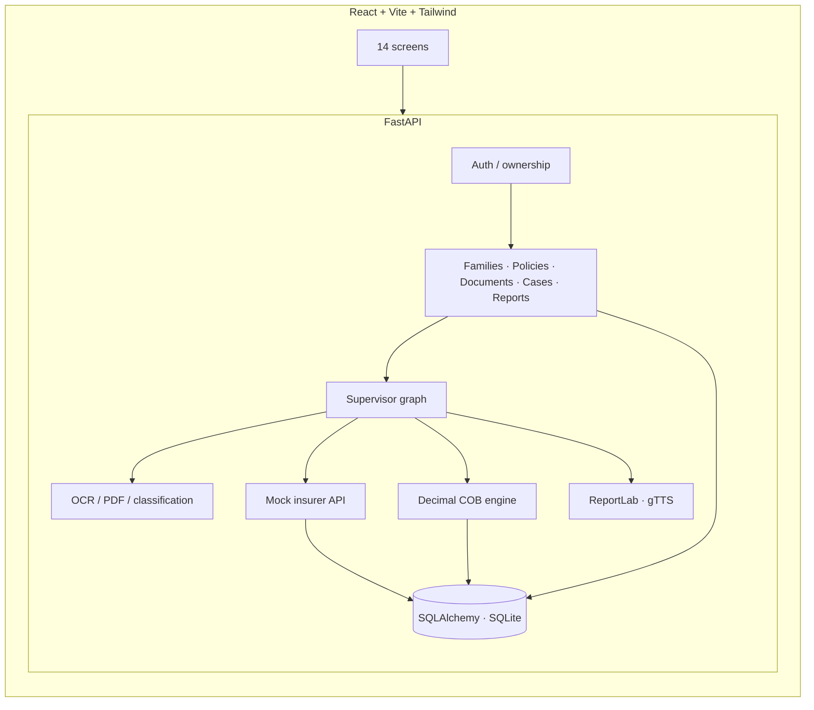

# DuCO Agent

**Your health insurance, coordinated intelligently.**

DuCO Agent is a dynamic, multi-user coordination-of-benefits platform for households with more than one health policy. It reads medical documents with OCR, extracts and scores what it finds, coordinates every covering policy under configurable rules, and calculates the split between insurers and the patient with a deterministic Decimal engine.

The product principle is deliberate:

> **AI understands the documents. A deterministic engine calculates the money. A supervisor proves the workflow ran.**

This is not a chatbot and not a static dashboard. Families, members, policies, policy versions, documents, claims, accumulators and results all live in the database and are created through the API or the UI. The Priya/Aarav demo is a seeded fixture set — it does not define the architecture.

---

## Quick start

```bash
# 1. Python
python3 -m venv .venv
source .venv/bin/activate
pip install -r requirements.txt

# 2. Frontend (build once; FastAPI then serves it on the same port)
cd web && npm install && npm run build && cd ..

# 3. Run
uvicorn server.main:app --host 127.0.0.1 --port 8000
```

Open <http://127.0.0.1:8000>. The API docs are at `/docs`, and `/api/health` is the liveness check.

**Image OCR needs the Tesseract binary** (`tesseract-ocr` on Debian/Ubuntu, `brew install tesseract` on macOS). Text PDFs work without it. The demo fixtures include a PNG and a JPG, so install it before running the demo.

### Development mode

```bash
# terminal 1
uvicorn server.main:app --reload --port 8000

# terminal 2 — Vite proxies /api and /mock-insurers to :8000
cd web && npm run dev
```

### One-command demo

```bash
make demo
```

Seeds the demo household and opens the API on port 8000. Then click **Explore demo** on the landing page.

**Demo account:** `demo@duco.health` / `DuCOdemo!23` (fictional data; every insurer response is simulated).

---

## The demo household

Nothing is hardcoded in the result path. The seed creates real rows and the same agents process them.

| Scenario | What it proves |
| --- | --- |
| **Aarav's ACL reconstruction + Priya's physiotherapy** | Two claims, two policies, primary/secondary ordering, pre-authorisation for both insurers, line-level explanation |
| **Therapy with an excluded equipment item** | A partially covered claim; the equipment line is excluded and stays with the patient |
| **Surgery estimate with missing clinical documents** | The pre-authorisation is rejected for a missing diagnosis; the case lists what to upload |
| **A second policy that has lapsed** | The inactive policy stays in the trace but is never allowed to pay |
| **A poor-quality scan that needs human review** | The confidence gate pauses before any money is calculated |

Each scenario gets its own policy-version snapshot so the scenarios are reproducible and do not consume each other's deductibles. That is a demo convenience; in a real household, benefit-year accumulators are shared across cases — and the platform models that per member.

The demo also includes a third member (Meera, a child) and a third policy (inactive) to exercise many-to-many membership and inactive cover.

---

## What is in the product

### Dynamic household and policy model
- Any number of households, members and policies; members and policies are many-to-many with roles (`policyholder`, `spouse`, `dependent`, `child`, `parent`).
- Policy terms: sum insured, deductible (total and used), co-insurance, out-of-pocket maximum, annual limit, sub-limits, exclusions, waiting periods, network restrictions, pre-authorisation threshold and penalty.
- Every edit to benefit terms creates a **new policy version**; each claim records the version it used.
- **Per-member accumulators** for deductible, OOP, annual limit and sub-limits. Aarav's deductible does not consume Priya's.
- Coordination rule per household and per case: own-policy-first, birthday, longest coverage, or manual.

### Multimodal document intelligence
- Accepts PDF, PNG, JPG, WEBP, TIFF, TXT (and rejects unknown types with a clear error); duplicate uploads are detected by SHA-256.
- Classifies invoice, estimate, policy schedule, radiology report, prescription, discharge summary and typed query.
- Text PDFs use PyMuPDF; scans go through Tesseract with three preprocessing strategies, scored on words recovered, money tokens and mean OCR confidence, with retries.
- Every field has `value`, `confidence`, `source`, `evidence` and `status`. Confidence comes from measured OCR word confidence or exact PDF text — never invented.
- CPT/HCPCS and ICD-10 candidates come from a curated catalogue with fuzzy matching; printed vs inferred vs unavailable is recorded. Clinical codes are suggestions until a person confirms them.
- An **optional** LLM enrichment hook (`DUCO_LLM_API_KEY`) can suggest a document type or fill a missing field. It is off by default, never overwrites a confident deterministic value, and anything it adds is marked for review. With no key, nothing is called.

### A real agent workflow
Eight roles, one supervisor and a persisted goal graph:

```
Intake → Document Intelligence → Coverage → COB → Compliance → Financial → Reporting → Critic
```

- The supervisor holds a goal graph with dependencies, dispatches the next eligible goal, records every step, and pauses for human review.
- Document Intelligence retries OCR strategies; the Financial agent recalculates if an invariant fails; the critic refuses to declare success when a deliverable or reconciliation is missing.
- Human-in-the-loop: low-confidence or missing fields create review items. The run stops before eligibility or money. After correction, the case resumes from its persisted state.
- Each event records agent, goal, state, action, tool, inputs, observation, checks, decision, next action, status, timestamp and duration. The UI shows the live trace; the API exposes the same JSON.

This is an explicit stateful graph runtime in the spirit of a LangGraph supervisor. LangGraph itself was not used because the workflow must run offline, persist checkpoints in the same SQLite transaction as the case, and support pause/resume across HTTP requests without a separate graph server. `server/agents/runtime.py` is the small graph engine; swapping in LangGraph would mean replacing that file and keeping the node contract.

### Deterministic money engine
`duco_agent/engines/coordination.py` is pure, side-effect free and Decimal-only.

For each line and each plan, in payer order:

1. determine eligibility (policy status, dates, waiting period, network, exclusion);
2. apply a sub-limit cap;
3. apply the contractual/network rate;
4. apply the deductible;
5. apply co-insurance;
6. apply the pre-authorisation penalty, if the request was not approved;
7. apply the out-of-pocket maximum (the plan absorbs the excess);
8. apply the annual benefit limit (excess moves to the patient, not the OOP cap).

The next plan sees only the covered residual the earlier plans left. It cannot pay more than that residual. Exclusions stay excluded unless the policy explicitly covers the primary's exclusions.

Invariants are checked on every run:
- billed = insurer payments + patient liability + contractual adjustments;
- allowed = billed − exclusions − contractual adjustments;
- no plan pays more than its allowed amount;
- no secondary pays more than the primary residual;
- deductible, OOP, annual limit and sub-limits stay within policy maxima;
- no negative amounts;
- the patient total equals the sum of its lines.

A failed invariant does not get published: the financial agent recalculates once and then the supervisor holds the case for review.

### Reports and letters
- JSON financial breakdown (machine-readable, line-level).
- Printable HTML cost-flow report.
- Execution trace JSON.
- A PDF pre-authorisation letter per required insurer, with patient, policy, codes, estimate, clinical basis, coordination position, supporting-document list and an explicit **request-not-approval** statement.
- An audio briefing (gTTS, Indian English) with a text-script fallback if the TTS service is unavailable.
- Downloads are owner-scoped and served with no-store headers.

### Product experience
- Landing page, auth, dashboard, family, policies, policy detail, documents, document review, case creation, live agent monitor, results, financial breakdown, letters, history, settings/privacy.
- Cost-flow waterfall, donut, per-line adjudication, deductible/OOP utilisation, payer-order evidence, coverage gaps.
- **Explain My Bill:** select any line to see billed → adjustments → deductible → co-insurance → each insurer → patient.
- **What-if simulator:** change a deductible, co-insurance or OOP maximum and see the hypothetical patient share. It is explicitly labelled hypothetical and never mutates the stored claim.
- **Coverage gap detector:** exclusions, missing codes/documents, inactive policies, pending/rejected authorisations.
- English/Hindi labels and plain-language financial explanations; amounts stay INR.
- Responsive layout and accessible focus states.

---

## Architecture



### Repository layout

```
server/
  main.py                 FastAPI app, SPA serving, security headers
  config.py               env-driven configuration
  db.py                   engine, session, SQLite pragmas
  models.py               users, families, members, policies, versions, accumulators,
                          documents, cases, claims, lines, reviews, events, preauth,
                          adjudications, mock claims/logs, reports, simulations
  schemas.py              Pydantic request contracts
  security.py             JWT, PBKDF2, ownership checks
  serializers.py          API response shapes
  agents/
    runtime.py            persisted supervisor + goal graph
    nodes.py              eight specialist nodes
  services/
    document_intel.py     validation, OCR retries, classification, fields, confidence
    llm.py                optional structured-output enrichment
    coverage.py           plan mapping + configurable payer order
    accumulators.py       per-member benefit-year usage
    insurer_mock.py       simulated eligibility/benefits/claims/pre-auth
    results.py            results, trace, explain, gaps, dashboard, what-if
    reports.py            JSON/HTML/PDF/audio/trace artefacts
    demo.py               dynamic demo seed + scenario snapshots
    policies.py           versioning + extraction hand-off
duco_agent/
  engines/coordination.py pure Decimal COB engine (platform)
  engines/cob_engine.py   original assessment engine (legacy CLI demo)
  tools/                  OCR, PDF, insurer transport
  codes.py                curated CPT/ICD catalogue + matchers
web/                      React 18 + Vite + TypeScript + Tailwind
tests/                    39 tests: engine, extraction, pipeline, API, workflow
docs/                     architecture, rules, security, QA
fixtures/                 generated demo documents (fictional)
run_demo.py               original offline CLI scenario (still works)
```

### Data integrity decisions
- Money is `Numeric(14,2)` in the database and `Decimal` in Python; no floats in the calculation path.
- A re-run is idempotent: the accumulators consumed by the previous run of the same case are reversed before recalculating, including sub-limit usage. Running the main demo twice produces the same ₹29,180 patient share.
- Per-member accumulators are keyed by `(policy_version, member)`. The policy schedule's "already used" amounts seed only the policyholder; dependants start at zero.
- Every claim stores the plan result per line, so the UI and reports never recompute money from a different rule set.
- The mock insurer claim endpoint runs the same engine for that policy so its response and the platform's calculation can be compared; both are labelled simulated.

---

## API

Interactive OpenAPI documentation: `/docs`.

| Area | Endpoints |
| --- | --- |
| Auth | `POST /api/auth/register`, `POST /api/auth/login`, `GET /api/auth/me` |
| Families | `POST/GET /api/families`, `GET/PATCH/DELETE /api/families/{id}`, `POST/GET /api/families/{id}/members`, `PATCH/DELETE /api/members/{id}` |
| Policies | `POST/GET /api/policies`, `GET/PATCH/DELETE /api/policies/{id}`, `POST /api/policies/{id}/versions`, `GET /api/policies/{id}/accumulators`, `POST /api/policies/{id}/members`, `POST /api/policies/extract` |
| Documents | `POST /api/documents/upload`, `GET /api/documents`, `GET /api/documents/{id}`, `GET /api/documents/{id}/file`, `PATCH /api/documents/{id}`, `POST /api/documents/{id}/confirm`, `POST /api/documents/{id}/reprocess` |
| Cases | `POST/GET /api/cases`, `GET/PATCH/DELETE /api/cases/{id}`, `POST /api/cases/{id}/analyze`, `GET /api/cases/{id}/results`, `GET /api/cases/{id}/trace`, `POST /api/cases/{id}/review`, `GET /api/cases/{id}/gaps`, `POST /api/cases/{id}/simulate`, `GET /api/cases/{id}/lines/{line_id}/explain` |
| Reports | `GET /api/cases/{id}/reports`, `GET /api/cases/{id}/reports/{report_id}/download`, `GET /api/cases/{id}/letters`, `POST /api/cases/{id}/preauth/{preauth_id}/refresh` |
| Workspace | `GET /api/dashboard`, `GET /api/meta`, `GET /api/settings/profile`, `PATCH /api/settings/profile`, `GET /api/settings/export`, `DELETE /api/settings/account?confirm=true` |
| Simulated insurers | `POST /mock-insurers/eligibility`, `/benefits`, `/claims`, `/pre-authorization`; `GET /mock-insurers/claims/{reference}` |

The mock endpoints are mounted outside `/api` exactly as specified. They are unauthenticated sandbox endpoints — documented as a deliberate prototype limitation, not a production design.

---

## Tests

```bash
python -m pytest -q
```

Current result: **40 passed**.

The suite covers the Decimal engine (deductible, co-insurance, OOP cap, annual limit, sub-limits, exclusions, pre-auth penalty, three plans, contractual adjustment, reconciliation, accumulators, explain parts), document classification, code resolution, upload validation and dedup, auth and ownership, many-to-many members/policies, an end-to-end case with human review, generated reports and PDF content, the what-if simulator, dynamic mock insurer outcomes, and an inactive-policy case.

The tests use a temporary SQLite database and data directory; they do not touch the demo database.

---

## Honest limitations

- **Everything is local.** SQLite and a single in-process background thread. No Redis, Celery or multi-worker queue. A production build needs a task queue and a shared checkpointer.
- **Insurers are simulated.** No real insurer or TPA API is called. All responses are labelled. The letters are drafts and no insurer receives them.
- **The engine models primary/secondary ordering.** Indian indemnity insurers may settle multiple policies on a contribution basis instead; the UI and docs expose this as an assumption. Confirm the basis with both insurers.
- **CPT/ICD coverage is a curated subset**, not a licensed code set. Every inferred code needs confirmation; clinical code assignment is not a diagnosis.
- **LLM enrichment is optional and off.** When enabled, it is a second opinion only; the deterministic extractor remains authoritative.
- **Audio** uses gTTS, which needs network access; if unavailable the platform generates the script and marks the audio as script-only.
- **Security is prototype-grade.** PBKDF2 password hashing, JWT sessions, owner-scoped reads, private file storage, MIME/size validation and duplicate hashing are implemented. Field-level encryption, KMS, read audit logs, rate limiting, consent/erasure workflows, HTTPS termination and a formal threat model are **not**. See [`docs/SECURITY.md`](docs/SECURITY.md).
- **No PDF text layer for Indian languages** is guaranteed; OCR is English-oriented.
- The original `run_demo.py` CLI scenario is preserved for the original assessment and uses the legacy engine (`duco_agent/engines/cob_engine.py`). The platform uses the new generic engine.

---

## Documentation

- [`docs/PLATFORM.md`](docs/PLATFORM.md) — product and API architecture, workflow states, UI map
- [`docs/COORDINATION_RULES.md`](docs/COORDINATION_RULES.md) — exact calculation order, assumptions, invariants
- [`docs/SECURITY.md`](docs/SECURITY.md) — implemented controls, production gaps, data handling
- [`docs/QA.md`](docs/QA.md) — test inventory and how to reproduce the acceptance scenario
- [`docs/ARCHITECTURE.md`](docs/ARCHITECTURE.md) — original assessment architecture (legacy CLI)
- [`docs/COB_RULES.md`](docs/COB_RULES.md) — original assessment benefit rules (legacy CLI)
