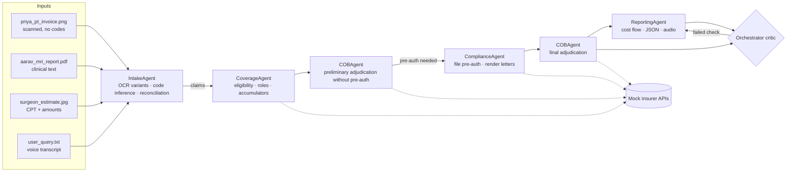

# DuCO-Agent

An agentic, multi-modal coordination-of-benefits (COB) assistant for a household with **dual health cover**: Priya and Aarav Sen are each the primary policyholder on their own employer plan and a dependent on the other's.

DuCO-Agent reads the paperwork a real household would hand over — a crumpled physiotherapy invoice with handwritten notes and **no billing codes**, an MRI report, a phone photo of the surgeon's estimate, and a voice-to-text request — then decides which plan pays first for each claim, files pre-authorisation, computes what the family actually pays in INR, and produces a cost-flow page, the two pre-auth letters and a spoken briefing.

```
python -m pip install -r requirements.txt
python run_demo.py
```

Outputs land in `outputs/`. The run is deterministic and offline: the mock insurer APIs are in-process by default (or HTTP with `--mode http`), the OCR uses local Tesseract, and no paid model API is called.

---

## What the run produces

| Artifact | What it is |
| --- | --- |
| `outputs/cost_flow.html` | Printable one-page cost flow: payment split per claim, per-line table, pre-auth references, and the rules used |
| `outputs/financial_breakdown.json` | Every adjudication (line level), accumulators, pre-auth records — the source of the page's numbers |
| `outputs/preauth_letters/*.pdf` | One letter per insurer for the surgery, with the diagnosis/CPT codes, provider registration and coordination position |
| `outputs/briefing.mp3` + `briefing_script.txt` | A ~60-second spoken briefing for the patient |
| `outputs/run_trace.json` | The agent's thought → action → observation → check → decision record |
| `outputs/run_summary.json` | Headline numbers for the run |

### The numbers this scenario produces

| | Aarav — ACL reconstruction | Priya — physiotherapy | Household |
| --- | ---: | ---: | ---: |
| Billed | ₹4,50,000 | ₹30,000 | ₹4,80,000 |
| Insurer2 pays | ₹4,02,300 (primary) | ₹2,970 (secondary) | ₹4,05,270 |
| Insurer1 pays | ₹34,160 (secondary) | ₹19,200 (primary) | ₹53,360 |
| **You pay** | **₹13,540** | **₹7,830** | **₹21,370** |
| Saved by coordinating | ₹34,160 | ₹2,970 | **₹37,130** |

Because the household sized plans on their own, using coordination costs them ₹21,370 instead of ₹58,500 if each bill went to one plan only. Filing the pre-authorisations is worth ₹17,740 — that is what the same claims would cost if neither letter existed.

---

## Architecture



The control flow is a supervisor loop, not a script: `Orchestrator` keeps a goal list with dependencies, dispatches the next unmet goal, and runs a critic over the artifacts before it declares the run finished. Each specialist agent logs its own thought → action → observation → checks → decision into `outputs/run_trace.json`.

### Why it is agentic rather than a linear chain

1. **Plans, then chooses.** `Orchestrator` holds goals with dependencies and picks the next one whose prerequisites are met.
2. **Treats extraction as a hypothesis.** `IntakeAgent` scores each OCR preprocessing variant on evidence (service lines recovered, whether the lines reconcile with the printed total, mean word confidence) and retries with another strategy when a check fails, instead of accepting the first read.
3. **Infers what the document omits.** The invoice has no codes at all: CPT 97161/97110 are derived from the service descriptions with a confidence score, and the equipment line is recognised as a non-covered benefit.
4. **Runs the claim to discover a requirement.** `COBAgent` adjudicates first with no pre-authorisation, sees the penalty, and only then asks `ComplianceAgent` to file — the letters are a reaction to a computed loss, not a step in a script.
5. **Validates its own numbers.** Every adjudication must satisfy conservation (plan payments + household share = bill), plans never pay more than allowed, and the secondary never pays more than the primary left. A failing check re-renders the report; the trace shows which checks ran.
6. **Cross-checks the documents.** The MRI supplies the diagnosis codes, the estimate supplies the CPT codes, the transcript supplies the goals, and the invoice total is reconciled against the sum of its lines.

Full detail: [`docs/ARCHITECTURE.md`](docs/ARCHITECTURE.md). The benefit rules and every assumption: [`docs/COB_RULES.md`](docs/COB_RULES.md).

---

## The four inputs

All four are generated by `fixtures/generate_fixtures.py`, so the demo is reproducible and contains no real patient data.

| File | What makes it hard |
| --- | --- |
| `priya_pt_invoice.png` | Phone scan with rotation, shading and grain; handwritten billing note; **no CPT/ICD codes**; quantities partially illegible |
| `aarav_mri_report.pdf` | Clinical prose, no codes — the tears must be recognised and mapped to ICD-10 |
| `surgeon_estimate.jpg` | Photographed billing sheet; codes printed, total must be reconciled |
| `user_query.txt` | Voice-to-text, no structure — the goals have to be extracted |

The intake trace records which preprocessing pass won and why. For example, on the invoice the `clean` pass recovers the three line amounts and the printed total; the quantity on one line is unreadable, so it is derived from `amount ÷ rate` and cross-checked against the reconciled total.

## Mock insurer APIs

`duco_agent/mock_api/service.py` exposes eligibility, benefits with year-to-date accumulators, pre-auth submission and claim adjudication for both plans. The same handlers back two transports:

```bash
python run_demo.py                    # in-process (default, no ports)
python -m duco_agent.mock_api.server --port 8765   # HTTP server
python run_demo.py --mode http        # client talks to the server
```

## Project layout

```
duco_agent/
  agents/         base (trace, retry loop), intake, coverage, cob, compliance, reporting
  engines/        cob_engine (deterministic maths), preauth (PDF letters)
  mock_api/       service handlers + stdlib HTTP server
  tools/          OCR with preprocessing variants, PDF text, insurer API client
  extraction.py   the four document parsers, each field carrying confidence
  codes.py        CPT / ICD catalogue + fuzzy matching
  orchestrator.py supervisor: goals, dispatch, critic
fixtures/         generator + the four generated inputs
tests/            engine arithmetic, extraction, retry loop, end-to-end run
docs/             architecture, benefit rules, pull-request descriptions
```

## Tests

```bash
python -m pytest -q      # 16 tests
```

The suite covers deductible/coinsurance arithmetic, the OOP maximum, the secondary-only-residual rule, the pre-auth penalty, conservation of every claim, noisy invoice parsing, the retry loop, and a full run that asserts each artifact exists.

## Design decisions

* **Deterministic maths, agentic control.** The rupee arithmetic lives in a pure engine with tests; the agents decide *what* to compute and *when*. That keeps claims explainable and auditable.
* **Confidence is explicit.** Every extracted field and inferred code carries a score and a source (`ocr`, `derived`, `inferred`, `cross-checked`), so a low-confidence code is visible on the report rather than silently trusted.
* **Two adjudications, on purpose.** The preliminary pass exists to measure the pre-auth penalty; the final pass is what the household sees.
* **No LLM dependency.** The system runs offline. The agent's reasoning is an explicit controller, which makes the trace reproducible — a reviewer can re-run it and get the same numbers.
* **Stdlib HTTP server.** The mock insurer API has no framework dependency, so `make demo` works on a clean machine.

## Limitations

* Plan terms (deductibles, coinsurance, OOP maxima, pre-auth thresholds) are **simulated for this assessment**; they are not real policy wording and the letters are drafts.
* The CPT/ICD catalogue is a curated subset chosen for this scenario, not a licensed code set. A production build would use a maintained code service.
* OCR quality depends on the scan; the agent flags low-confidence fields but does not invent values.
* Claims are adjudicated as pre-service estimates (the surgery is upcoming), not as paid claims.
